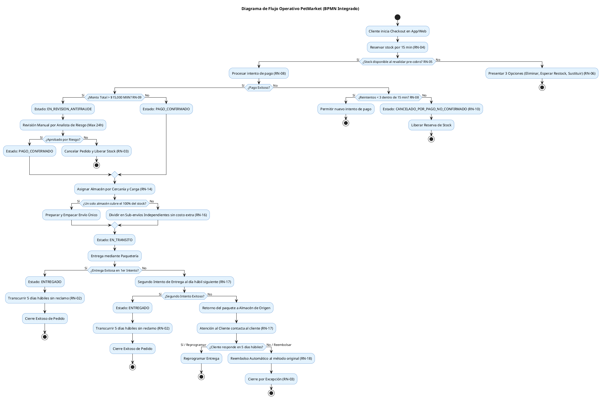

# Proceso de Negocio Integrado (BPMN) - PetMarket

Este documento describe el flujo operativo end-to-end de PetMarket desde el inicio del proceso de checkout hasta la entrega exitosa o resolución de excepciones (cancelaciones, devoluciones e intentos fallidos de entrega).

---

## Diagrama de Flujo de Negocio (PlantUML BPMN)

---

## Resumen de Puntos de Decisión Clave
1. **RN-05 (Revalidación)**: Ocurre antes de enviar el cobro a la pasarela.
2. **RN-09 (Antifraude)**: Detiene temporalmente el pedido si excede \$15,000 MXN.
3. **RN-16 (División)**: Sub-envíos independientes con folios derivados y guías propias.
4. **RN-17/18 (Entrega Fallida)**: Límite de 2 intentos antes de retornar a almacén y proceder a reembolso por inactividad.
