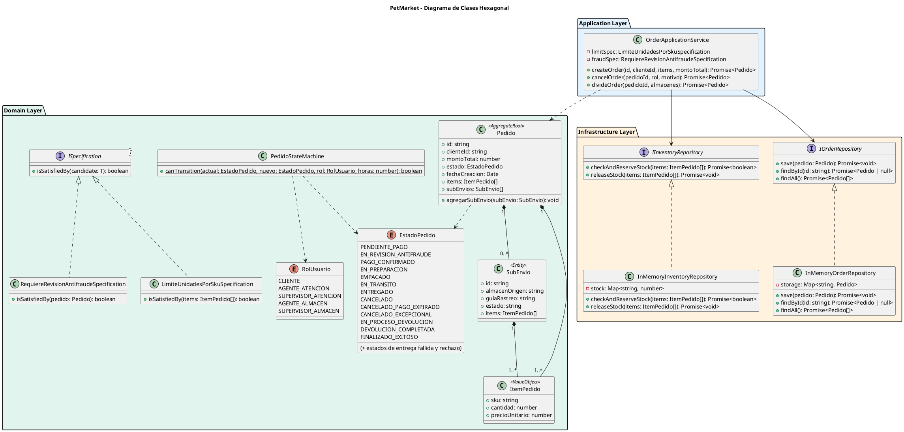
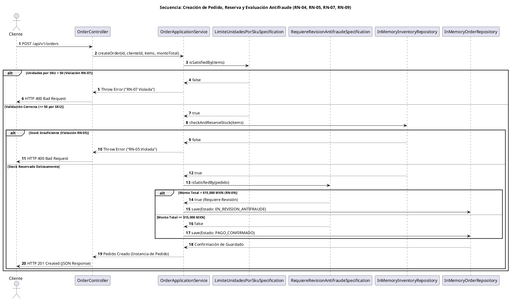

# Diagramas UML de Arquitectura - PetMarket

Este documento contiene las representaciones arquitectónicas en PlantUML que detallan la estructura de clases de la capa de dominio, aplicación e infraestructura, así como el flujo de secuencia para el procesamiento de pedidos y evaluación antifraude.

---

## 1. Diagrama de Clases (Arquitectura Limpia / Hexagonal)

---

## 2. Diagrama de Secuencia (Creación de Pedido y Evaluación Antifraude)

